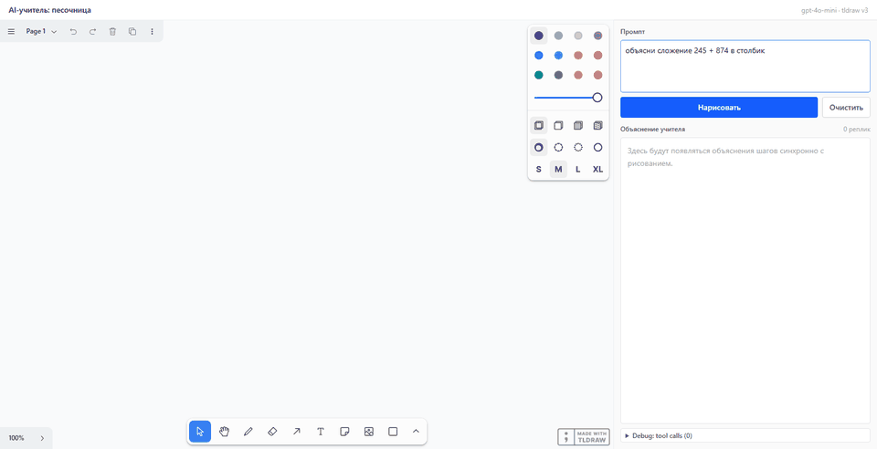
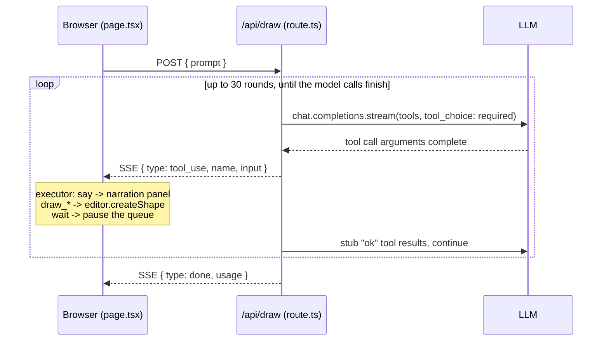
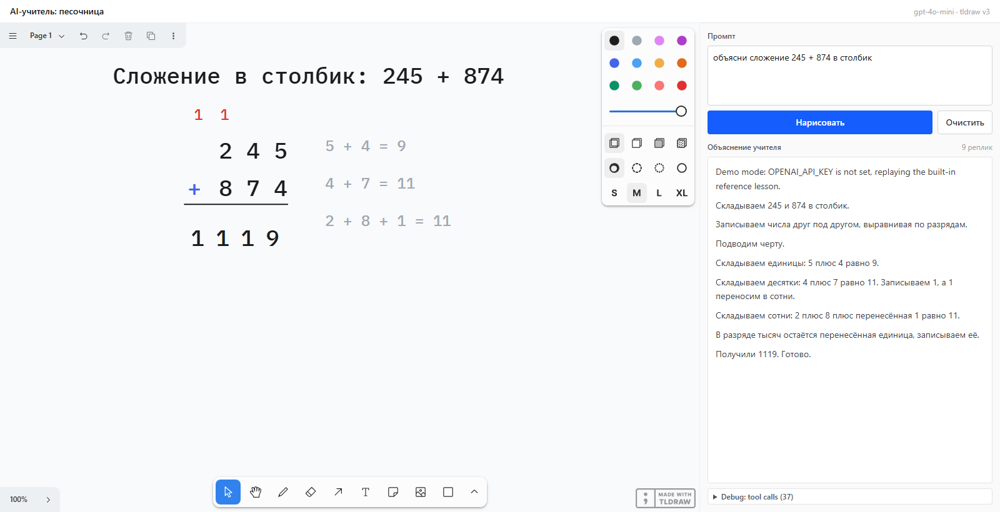

# LLM Whiteboard Tutor

**An LLM that teaches maths the way a teacher does: at the board, one stroke at a time. The model never draws pixels. It streams tool calls, and each call becomes an animated step on a live tldraw canvas while the model is still generating.**



*Column addition 245 + 874: the teacher's narration on the right, the board on the left, carries in red, a highlight on each column as it is added.*

Chat tutors answer with walls of text, but children learn arithmetic by watching someone write, point and pause. This prototype tests whether a model can run a lesson at the whiteboard instead of explaining in prose.

| | |
|---|---|
| **Idea** | Tool use as a rendering protocol: the model emits teaching actions, the browser turns them into shapes |
| **Stack** | Next.js 15 (App Router), React 18, TypeScript, tldraw v3, OpenAI SDK v6 (function calling + streaming), Server-Sent Events, Tailwind v4 |
| **Model** | `gpt-4o-mini` by default; any function-calling model works |
| **Size** | ~1,300 lines of TypeScript, built in 2 days |
| **Runs without a key** | Yes: a built-in reference lesson replays through the same pipeline |

---

## How it works



- **Streamed tool calls.** The route listens for `tool_calls.function.arguments.done` and forwards each finished call as its own SSE event. Shapes appear while the model is still writing the rest of the lesson.
- **Fire-and-forget tools.** Drawing happens in the browser, so the server answers every call with a stub `ok` and keeps the loop going. `tool_choice: "required"` forbids plain-text answers; the only way to stop is the `finish` tool.
- **Pacing is part of the protocol.** The client awaits every `wait` call before executing the next one, and shapes fade in, so a lesson reads at a child's speed rather than appearing all at once.
- **Batched phases.** The prompt asks for 8 to 15 calls per response, one logical phase each (write the numbers, add the units, carry the ten), which keeps a full lesson within 4 to 6 model rounds.

## The drawing toolkit

Nine provider-agnostic tools defined once in JSON Schema (`lib/tools.ts`) and adapted to OpenAI function calling in one line:

| Tool | Effect on the board |
|---|---|
| `draw_text` | Text with size, colour and weight |
| `draw_rectangle`, `draw_circle`, `draw_line` | Basic geometry |
| `draw_arrow` | Arrow with an optional label |
| `highlight_region` | A pastel highlight that removes itself after `duration_ms` |
| `wait` | A pause that sets the rhythm of the explanation |
| `say` | The teacher's line for the current step, shown in the narration panel |
| `finish` | Ends the lesson; never forwarded to the client |

The executor (`lib/executor.ts`) maps each call to `editor.createShape` on the tldraw canvas, so a lesson stays an editable, replayable set of shapes instead of a flat generated image.

## Teaching the model to write a column

Getting a model to place digits in the right columns is the hard part. The system prompt gives it an explicit coordinate system (an 800×600 board, character widths per font size, minimum row and column spacing) and a fully worked reference lesson with every coordinate spelled out. Carries go in red above the column they move into; side calculations go in grey to the right of the sum.

The same reference lesson lives in `lib/demo-lesson.ts`. Without `OPENAI_API_KEY`, `/api/draw` replays it in the exact event format the model produces, which makes the executor, pacing and UI testable for free. It is a scripted sample, not a recorded model run.



## Try it

```bash
npm install
npm run dev                          # http://localhost:3000, demo lesson without a key
cp .env.local.example .env.local     # add OPENAI_API_KEY for real lessons
```

Type a topic such as "объясни сложение 358 + 467 в столбик" ("explain 358 + 467 in a column") and press **Нарисовать** ("Draw"). To change the model, edit `MODEL` in `app/api/draw/route.ts`.

## Gotchas worth knowing

- **Shell variables beat `.env.local`.** Next.js gives the process environment priority, so an empty `OPENAI_API_KEY` exported in your shell silently hides the one in `.env.local`. Check with `echo "[$OPENAI_API_KEY]"`.
- **Node's fetch ignores `HTTPS_PROXY`.** On proxied networks, `instrumentation.ts` installs a global `undici.ProxyAgent` at server start. `undici` and `node:` imports are marked as webpack externals so the server bundle still compiles.
- **Workspace root detection.** `next.config.ts` pins `outputFileTracingRoot`, because Next.js can adopt a stray `package-lock.json` higher up the tree as the project root.

## Project layout

```
app/page.tsx            tldraw canvas, prompt panel, narration, debug log of tool calls
app/api/draw/route.ts   system prompt, agent loop, SSE stream, offline demo
lib/tools.ts            the 9 tool schemas (provider-agnostic JSON Schema)
lib/executor.ts         tool call -> tldraw shape, highlights, pacing
lib/demo-lesson.ts      the reference lesson used in demo mode
instrumentation.ts      optional proxy support for server-side fetch
```

## Status and honest caveats

- A two-day R&D prototype that runs locally. It was never deployed to real students.
- There are no automated tests or evals: lessons were checked by eye, prompt by prompt.
- Lessons target Russian-speaking fifth-graders, so the system prompt, the UI and some code comments are in Russian.
- Code was written AI-first with Claude Code; the idea, the lesson design, the tool protocol and the acceptance are mine. The concept later shaped the lesson canvas of a larger AI-tutor product.

## License

MIT
